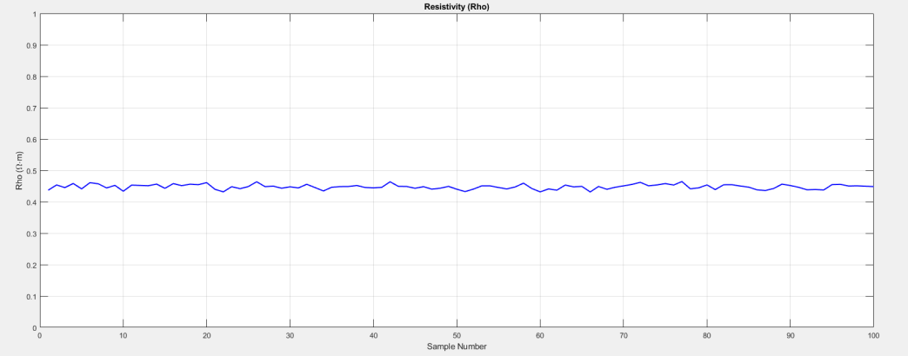

# STM32-Based Characterization of FDM-Printed Conductive TPU Bend Sensors

Low-cost, 3D-printable bend sensors made from carbon-filled conductive TPU (Recreus Filaflex Conductive), with an STM32 measurement system and test rigs for bending and stretching.

> Final project, Dokuz Eylül University, Electrical & Electronics Engineering (June 2026).
> Advisor: Assoc. Prof. Dr. Ahmet Özkurt

## Aim

Commercial bend sensors are expensive and cannot be customized. This project measures how well conductive TPU can replace them in a data glove. It studies the **forward problem** (angle → resistance). The inverse problem (resistance → angle) is future work.

## Measurement systems

| System | Hardware | Used for |
|---|---|---|
| Resistance/resistivity | STM32 Nucleo-G070RB, 2 ADC channels + DMA | Raw filament and printed samples |
| Bend test | Arduino Nano + servo motor | 0°–90° bend/release, 700 cycles |
| Stretch test | Arduino Mega + step motor (built by the advisor) | Axial stretching, 10 and 20 cycles |

**Differential voltage divider.** A 4-wire (Kelvin) measurement was unstable on soft, porous TPU because of the solder contacts. Instead, ADC1 reads the voltage at the start of the TPU and ADC0 reads it at the end, with a reference resistor in series to GND:

`R_TPU = R_ref · (V1 − V2) / V2`

- Firmware: C, STM32CubeIDE, HAL, ADC with DMA (circular mode)
- Noise reduction: 1000-sample block averaging
- Data: UART (115200 baud) to a live MATLAB plot of R and rho

Flowcharts: [STM32](images/stm32_code_flowchart.png) · [MATLAB](images/matlab_code_flowchart.png)

## Main results

- **Resistivity:** raw filament ≈ 0.08 Ω·m. Printed samples: 0.26–1.18 Ω·m (depends on geometry, print direction and voids).
- **Negative piezoresistive effect:** resistance goes **down** when the sensor is bent or stretched. The explanation is the Poisson effect plus reorganization of the carbon percolation network.
- **Bend hysteresis (H_max, 0°–90°, 700 cycles):** 29.53–39.79 %. It grows as the sample gets thinner, and depends on angular velocity (22.65 % at 25 deg/s, about 31 % at 75–90 deg/s).
- **Stretching:** mean gauge factor from −0.34 to −9.96 (stretching) and −0.46 to −14.77 (releasing). True conductivity is 2.0–7.8 S/m.
- **Calibration:** bending and releasing need separate polynomial models, so one global model is not enough.

## Cost

| Sensor | Unit price |
|---|---|
| Commercial (SpectraFlex / Flex Sensor) | about 10–15 USD |
| Conductive TPU (1–3 g per sensor) | about 0.13–0.39 USD |

Geometry is customizable and the TPU can be printed directly on fabric. Hysteresis compensation may add development cost.

## Limitations

- Hysteresis is high (about 30–40 %), so compensation is needed for accurate angle estimation.
- Printed samples are anisotropic and have voids, so resistivity changes with geometry.
- Ambient temperature and humidity were not controlled.

## Future work

Build the **inverse model** (resistance → angle) with separate models for bending and releasing.

## Credits

- The stretching test system was designed by the advisor, Assoc. Prof. Dr. Ahmet Özkurt. Its data was analyzed in this project.
- Related work: A. Özkurt et al., "Geometrically Optimized FDM-Printed Conductive TPU Bend Sensors for Hand Rehabilitation," *Sensors*, 26(8), 2309, 2026. https://doi.org/10.3390/s26082309
- The MATLAB scripts were written with the help of an AI tool (Claude Sonnet 4.6). *(Check this against the file name issue above.)*

## Author

Zehra Miray Gülseren
