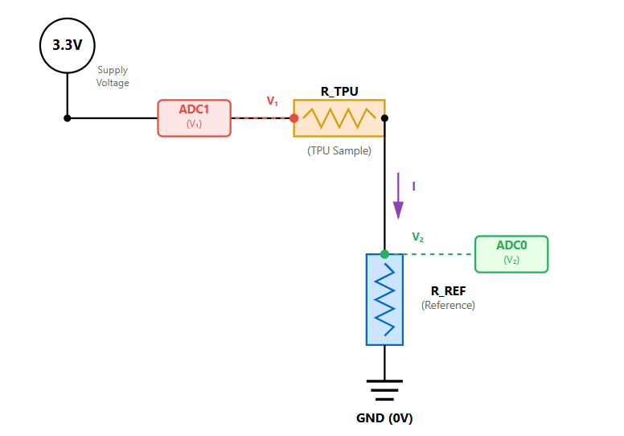
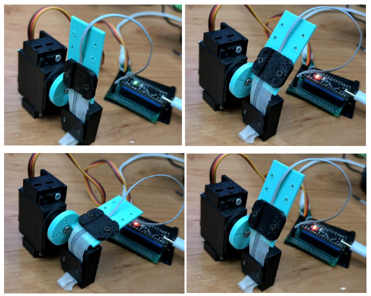
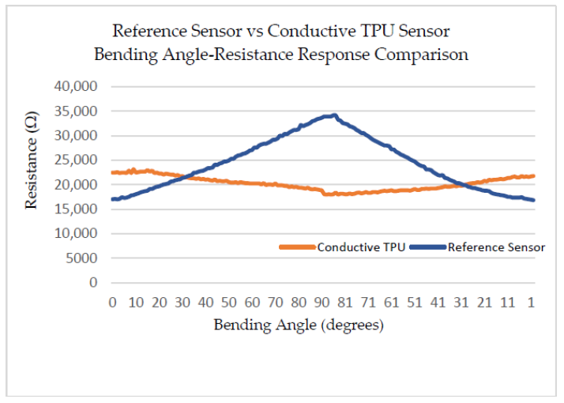
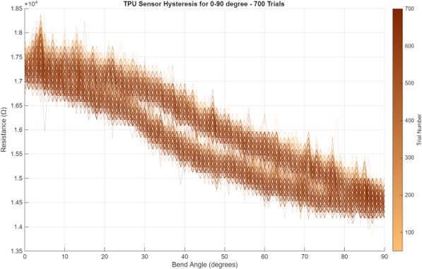
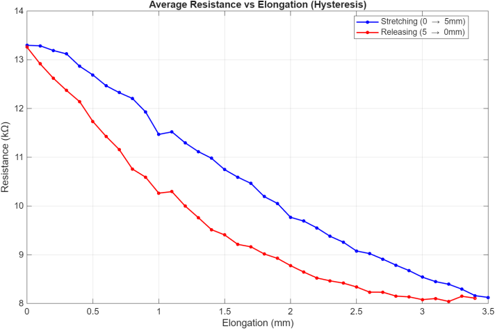

# STM32-Based Characterization of FDM-Printed Conductive TPU Bend Sensors

Low-cost, 3D-printable bend sensors made from conductive TPU (Recreus Filaflex), with an STM32 measurement system, a bend/hysteresis test rig and stretching tests. The goal is to check if this material can replace expensive commercial bend sensors in a data glove.

> Final project, Dokuz Eylül University, Electrical & Electronics Engineering (June 2026)
>
> Author: Zehra Miray Gülseren · Advisor: Assoc. Prof. Dr. Ahmet Özkurt
## Key Results

- Resistance **decreases** when the sensor is bent or stretched (negative piezoresistive effect).
- Bend hysteresis (H_max, 0°–90°, 700 cycles): **29.5 – 39.8 %**.
- Material cost per sensor is about **96–99 % lower** than a commercial flex sensor (about 0.13–0.39 USD vs 10–15 USD).
- Because of the high hysteresis, bending and releasing need separate calibration models.

## My Contribution

- Designed the **STM32 differential voltage divider** measurement system (ADC + DMA + UART).
- Designed the **Arduino Nano + servo bend test system** and ran 700-cycle hysteresis tests.
- Compared raw filament, printed samples, samples printed on fabric and a commercial sensor.
- Analyzed stretching test data (conductivity and gauge factor).
- The stretching test rig was designed by my advisor. I analyzed its data.

**AI assistance:** All MATLAB code in this project was written with the help of Claude Sonnet 4.6 (Anthropic).

## Measurement System

The 4-wire (Kelvin) method was not stable on soft, porous 3D-printed TPU, so a **differential voltage divider** was used. ADC1 reads the voltage at the start of the TPU, ADC0 reads it at the end, and a reference resistor is in series:

`R_TPU = R_ref · (V1 − V2) / V2`

- STM32 Nucleo-G070RB, C (HAL), 12-bit ADC with DMA, 1000-sample block averaging
- UART (115200 baud) to a live MATLAB plot of resistance and resistivity

## Bend Test System

A servo motor bends the sensor 0° → 90° → 0° for 700 cycles. An Arduino Nano reads a voltage divider and sends the data to MATLAB, which draws the hysteresis loop and calculates H_max. The angular velocity can be changed in the code.

## Results

- **Resistivity:** raw filament about 0.08 Ω·m. Printed samples 0.26–1.18 Ω·m (layers and voids change the value).
- **Hysteresis:** thinner samples have more hysteresis (29.53 % for 1.0 mm, 33.36 % for 0.25 mm lines).
- **Stretching:** gauge factor is negative for all 9 samples (from -0.34 to -9.96 while stretching).
- **Why:** when the material is stretched, it gets narrower (Poisson effect), carbon particles come closer and new conductive paths form, so resistance goes down.

## Limitations and Future Work

- Hysteresis is high (about 30–40 %), so compensation is needed for accurate angle measurement.
- Next step: build the inverse model (resistance → angle) with separate models for bending and releasing.

## Repository

- `Core/`: STM32CubeIDE firmware
- `arduino/bend_test/`: Arduino Nano bend test code
- `matlab/`: live dashboard, hysteresis analysis and stretching analysis scripts

## Reference

A. Özkurt et al., "Geometrically Optimized FDM-Printed Conductive TPU Bend Sensors for Hand Rehabilitation," *Sensors*, 26(8), 2309, 2026. https://doi.org/10.3390/s26082309
